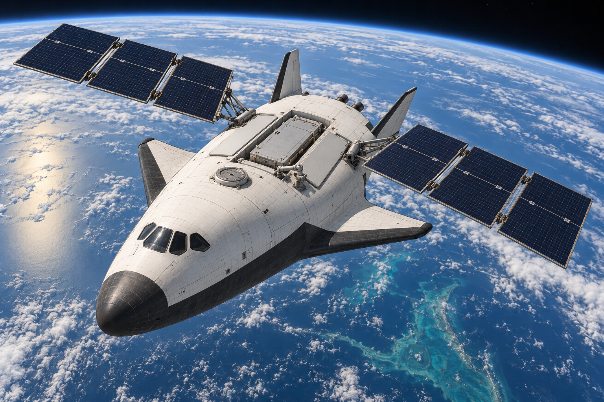

# KESTREL

**A compact shuttle successor for crew and cargo transport to low Earth orbit.**

KESTREL is a conceptual reusable lifting body that launches on a separate rocket, unfolds solar and cooling surfaces for orbital operations, and returns people and valuable cargo to a runway.



*Illustrative AI-generated concept art. The rendering does not validate geometry, panel area, mechanisms or clearances.*

## Read the design

Start with the [14-page engineering brief](kestrel-concept-brief.pdf). It covers the mission, architecture, mass allocation, energy and propulsion calculations, electrical and thermal systems, operations, development gates and primary aerospace references.

| Preliminary design target | Value |
| --- | --- |
| Destination | 400 km circular low Earth orbit |
| Crew | 6 people |
| Useful cargo to orbit / returned | 3 tonnes / 2 tonnes |
| Independent mission duration | 7 days |
| Orbital insertion mass | 25 tonnes |
| Dry mass, including growth allowance | 18 tonnes |
| Length / stowed aerodynamic span | Approximately 15 m / 8 m |
| Solar output under reference sunlit conditions | 25 kW |
| Nominal electrical load | 8 kW |
| Battery nameplate capacity | 40 kWh |

The 25-tonne orbital figure excludes unresolved launch-adapter, escape-system and shroud mass. The initial architecture recovers the booster and orbiter; its separate upper stage is expended with controlled disposal.

## Distinctive capabilities

- **Orbital transformation:** deployable solar arrays and separate radiators support powered payload work.
- **Recorded heat-shield inspection:** a robotic arm and sensors compare return surfaces against a baseline before deorbit.
- **Removable mission cassette:** standardized cargo or experiment carriers allow payload preparation alongside vehicle inspection.

These are proposed integrations of established ideas, not claims of patent novelty or demonstrated vehicle performance.

## Reproduce the calculations

The screening model uses Python 3 and its standard library. No additional packages are required.

```sh
python kestrel-sizing.py
```

The script prints JSON containing assumptions and calculated results. Compare its output with [the saved results](kestrel-sizing-results.json).

Selected calculations include approximately 339 m/s of main-maneuver delta-v, 13.7 kW of sunlit generation to sustain the assumed 8 kW load through eclipse, and 51 square metres of effective radiator area before the target allocation of 55-65 square metres. Model assumptions and boundaries are documented in the script and brief.

## Study status

This is a pre-Phase A concept and first-order sizing study dated 8 October 2026. It is not flight-certified, construction-ready or a substitute for integrated aerospace engineering.

Open work includes launch and escape integration, aerodynamic and structural analysis, detailed subsystem mass estimates, life-support endurance, radiator and array packaging, deployment reliability, software validation and repeat-flight operations. A mass growth of 3 tonnes **beyond the budgeted 18-tonne dry mass** consumes the entire 3-tonne cargo allowance at a fixed 25-tonne insertion limit.

The efficiency hypothesis is to reduce transported overhead, use solar electricity in orbit and improve maintainability. No percentage improvement in total mission energy, cost or reliability has been established. KESTREL also serves a smaller cargo mission than the original Space Shuttle; comparisons require a matched mission and selected launcher.

## Repository contents

| File | Purpose |
| --- | --- |
| [kestrel-concept-brief.pdf](kestrel-concept-brief.pdf) | Engineering brief and source references |
| [kestrel-orbital-concept.png](kestrel-orbital-concept.png) | Concept artwork |
| [kestrel-sizing.py](kestrel-sizing.py) | Reproducible screening calculations |
| [kestrel-sizing-results.json](kestrel-sizing-results.json) | Saved model output |
| [kestrel-image-prompt.txt](kestrel-image-prompt.txt) | Exact prompt and image-generation provenance |

The concept, calculations and brief were developed with Codex assistance. Artwork was produced with the built-in image-generation tool. Primary NASA and ESA references are linked in the brief; those organizations have not endorsed or validated KESTREL.
